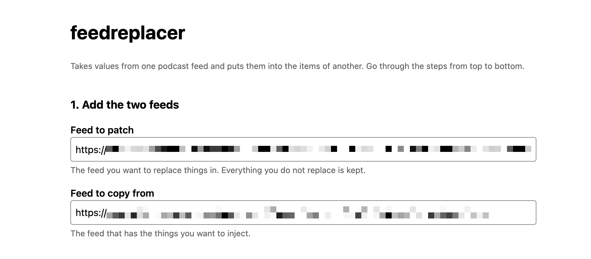
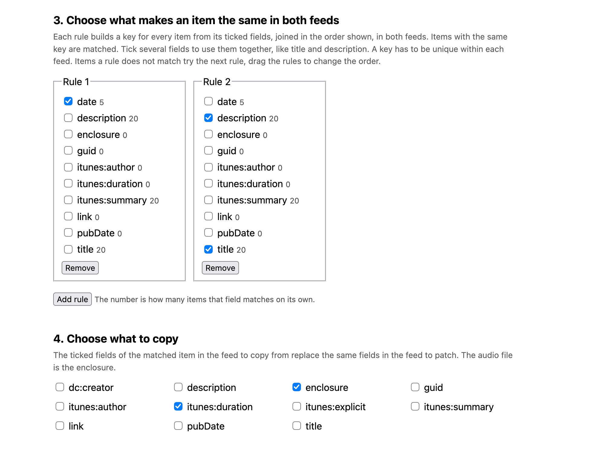
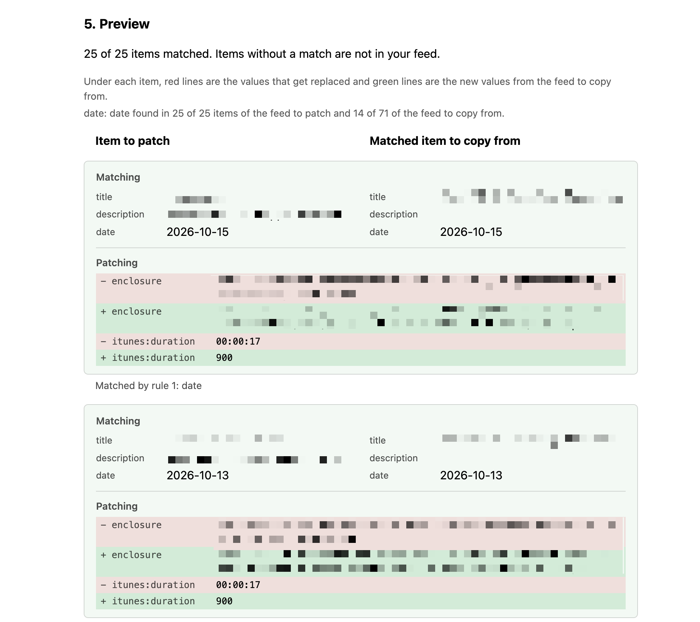
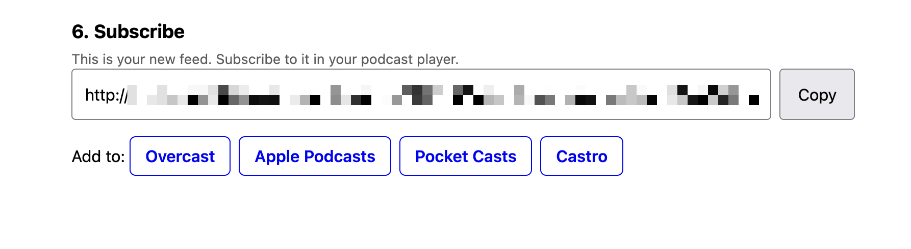

# feedreplacer

Patches the items of one feed (`base`) with values from another feed (`source`). Everything that is not replaced is kept. Items are paired by one or more fields (default `title`) and the `enclosure` and `itunes:duration` are taken from the source feed. Base items without a match are dropped.

- `match=title,description` pairs by both fields.
- `match=title|date` is an ordered list of rules. Items the first rule does not pair go to the next one.
- `extract=date=pubDate,title=YYYY-MM-DD` builds a `date` field from a date in `pubDate` or, if that is missing, in the title. It can be used in `match`.

```sh
docker run -e PORT=8080 -p 8080:8080 ghcr.io/dewey/feedreplacer
```

Open `/` for a small page that builds the feed URL, shows how many items match and has links to add the feed to podcast apps.

The page walks through the steps from top to bottom. Everything you set is kept in its URL, so a reload keeps it.









```
http://localhost:8080/feed?base=<url>&source=<url>[&match=title][&extract=...][&replace=enclosure,itunes:duration]
```

The URLs must be url-encoded:

```sh
curl -G localhost:8080/feed \
  --data-urlencode 'base=https://example.com/snippets.xml?token=abc' \
  --data-urlencode 'source=https://example.org/full.xml'
```

Run locally with `make dev` (`PORT=9000 make dev` for another port).
